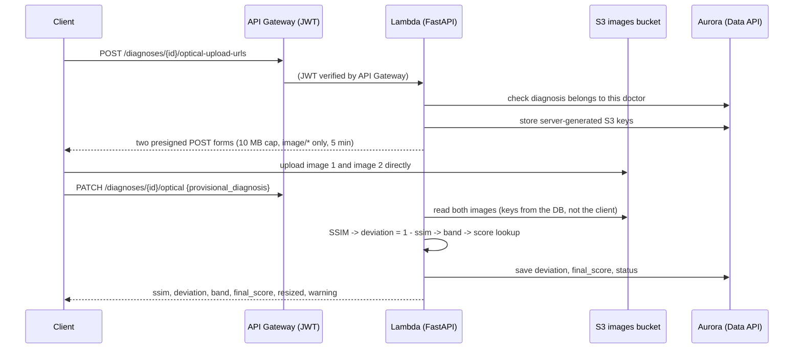
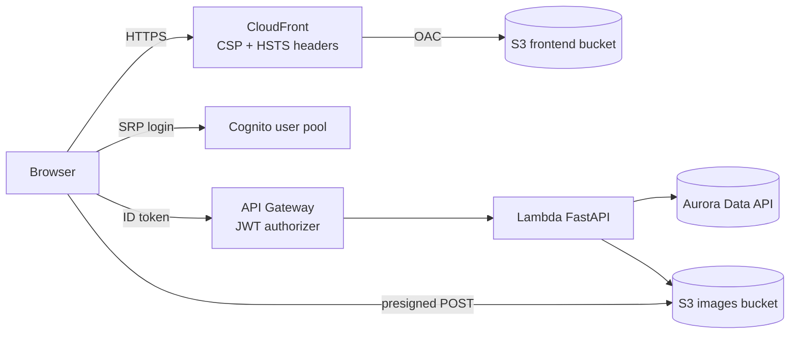

# Oroscope Architecture

## Infrastructure Components

1. VPC (Virtual Private Cloud) — 10.0.0.0/16
2. Database — Aurora Serverless v2 cluster (see below)
3. Two private subnets across two Availability Zones (private-subnet-a, private-subnet-b), grouped via the `aws_db_subnet_group` resource and assigned to the database
4. Security group attached to the database
5. Cognito User Pool
6. API Gateway
7. Control Plane Lambda
8. S3 images bucket (private, 30-day expiry placeholder)
9. S3 frontend bucket (private) + CloudFront distribution (Origin Access Control, security-headers policy)

## Database

**Type:** Aurora Serverless v2 — one `aws_rds_cluster` (storage/orchestration) plus one `aws_rds_cluster_instance` (`db.serverless`, the compute actually running queries).

**Version:** PostgreSQL 17.9 — not 16.4, the original choice; see `runbook.md` for why hardcoded engine versions go stale and how to check current ones.

**Scaling configuration:** `min_capacity = 0`, `max_capacity = 2`, `seconds_until_auto_pause = 3600`.

**User credentials:** Managed automatically by AWS Secrets Manager (`manage_master_user_password = true`) — no password ever appears in Terraform files, application code, or terminal history.

**Querying:** Done through the Data API, which uses IAM (SigV4-signed requests) to verify request authenticity.

## Data API

An AWS-managed API for accessing the database. It enables external compute — specifically, a non-VPC-attached Lambda — to query the Aurora database inside the private subnets via HTTPS, without requiring VPC attachment or a NAT Gateway.

1. **Empirically confirmed:** a real query executed successfully via the Data API against this cluster while the database security group had zero ingress rules, proving the connection path doesn't route through the VPC's customer-facing network layer.
2. It uses Secrets Manager-stored credentials to authenticate to the database once the request's IAM identity has been verified — the caller's IAM role needs both `rds-data:ExecuteStatement` (scoped to the cluster ARN) and `secretsmanager:GetSecretValue` (scoped to the secret ARN); the secret value itself is never returned to the caller.
3. The Data API is not free — $0.20-0.70 per million requests depending on region/volume, with 1 million requests/month free for the account's first year. See `cost-notes.md`.

## Compute (Inference)

The ML inference workload runs as an **AWS Lambda function packaged as a container image** (via ECR) (planned; skipped in the prototype, see ADR 0012) — not on Kubernetes/EKS. No persistent worker nodes, no always-on compute, consistent with this architecture's goal of near-zero cost at rest.

## Naming Convention

Format: `{project}-{environment}-{component}`
Tag set applied to every resource: `Environment`, `ManagedBy`, `Project`, `Name`.
Maintained centrally via a `locals` block, so every resource references `local.name_prefix` and `local.common_tags` rather than composing names manually.

## Networking

There is currently no NAT Gateway and no Internet Gateway anywhere in this VPC. Nothing inside the VPC ever needs outbound internet access — the database only responds to inbound Data API queries (security groups are stateful; no egress rules are needed for this to work), and the Lambda that needs to reach S3 or other AWS services is kept entirely outside the VPC, so it never requires a NAT Gateway or a VPC endpoint to reach anything.

Confirmed: the Stage 3 Lambda queries the database via the Data API with no VPC attachment, verified via direct invoke and a live foreign-key constraint rejection (see runbook.md).

## Compute (Control Plane)

The synchronous API layer runs as a single AWS Lambda function (`oroscope-dev-fastapi`),
packaged as a zip deployment (not a container image — that's reserved for the
heavier inference workload). FastAPI is wrapped with Mangum, which translates
API Gateway's event structure into an ASGI request FastAPI understands natively.

**Runtime:** Python 3.13 — the current maximum supported by Lambda. Local
development runs Python 3.14, which required cross-compiling dependencies
explicitly for Lambda (`manylinux2014_x86_64` wheels); see `runbook.md`.

**Auth model:** No JWT decoding happens in application code. The Cognito JWT
authorizer on API Gateway verifies the token's signature and expiry before
Lambda ever runs; the application only reads the already-verified `sub` claim
out of the event, via `request.scope["aws.event"]`.

**IAM permissions (least privilege, confirmed working via direct invoke):**
`rds-data:ExecuteStatement` and related actions scoped to the Aurora cluster's
ARN; `secretsmanager:GetSecretValue` scoped to the cluster's auto-generated
secret ARN; `s3:PutObject` and `s3:GetObject` on the objects of the images bucket
only (presigned uploads and analysis reads). No `*` resources anywhere in this role.

**Sizing:** 1024 MB memory, 30 s timeout (a 12 MP image pair takes ~4 s). The
control-plane zip is ~32 MB zipped / ~108 MB unzipped (limits: 50 MB / 250 MB).

**Empirically confirmed via direct `aws lambda invoke`, bypassing API Gateway
entirely:** cold start succeeds, all dependencies load correctly under the
Lambda runtime, Mangum correctly parses a full API Gateway v2 event, and the
auth-rejection path returns a clean 401 rather than an unhandled exception
when authorizer claims are absent.

## Edge (API Gateway)

HTTP API (v2), AWS_PROXY integration to the control-plane Lambda — the entire
raw event is handed to Mangum unmodified, no request reshaping at this layer.
A Cognito JWT authorizer validates token signature, expiry, issuer, and
audience before Lambda invocation; unauthenticated requests never incur
Lambda compute cost. Authorization is applied per-route: `/health` is
intentionally open, all patient/diagnosis routes require a valid JWT.

**CORS:** `allow_origins` is exactly the CloudFront origin
(`https://<distribution>.cloudfront.net`), set from Terraform. The images bucket
allows browser POST from the same origin only. This closes the gap recorded in
ADR 0009 (see ADR 0013). CORS is a browser rule, not authentication: the JWT
authorizer is still what protects the routes.

## Optical analysis flow (Stage 4a, ADR 0012)

Two photos (red light, blue light) are compared with SSIM; the deviation is turned into a band, then a 0-5 score. The DL inference step is skipped in the prototype, so `provisional_diagnosis` is entered by hand.

**Endpoints (all JWT-protected except /health):**

| Method + path                                | Purpose                                                    |
| -------------------------------------------- | ---------------------------------------------------------- |
| `POST /patients`, `GET /patients`        | Patients, scoped to the calling doctor                     |
| `POST /diagnoses/clinical-match`           | Creates the diagnosis (state initiator, status`pending`) |
| `PATCH /diagnoses/{id}/clinical-lookup`    | Differential diagnosis + advise from`clinical_rules`     |
| `POST /diagnoses/{id}/optical-upload-urls` | Presigned S3 upload forms; stores the S3 keys              |
| `PATCH /diagnoses/{id}/optical`            | SSIM -> band -> score; sets`complete`                    |

**Design decisions and why:**

- **Single Lambda, no container.** OpenCV + scikit-image is 441 MB unzipped (Lambda limit 250 MB). SSIM was re-implemented with numpy + Pillow (zip 32 MB). Same-size image pairs give results identical to the original OpenCV pipeline; resized pairs can differ by up to ~0.004 SSIM (the Borderline band is 0.04 wide). The API returns `resized`.
- **Images bypass the API.** API Gateway caps requests at 10 MB and Lambda at 6 MB; base64 adds a third. Presigned POST sends images straight to S3, with a policy enforcing size and type.
- **Server-chosen S3 keys.** The analysis step reads keys stored on the diagnosis, never a client-supplied key (prevents reading someone else's object).
- **Scoring in code, not a table.** 81-entry lookup (27 diagnoses x 3 bands: 78 sheet rows + Variable Diagnosis = 0 in each band), generated from the Excel by script (`scoring_engine.py`); no database round trip.
- **BOLA protection.** Every diagnosis query filters on `doctor_id`; a wrong or foreign id returns 404, same as a missing one.

**Deliberately not built yet:** DL inference (SageMaker Serverless or a container Lambda), SQS/SNS async processing (everything is synchronous, ~4 s for a 12 MP pair), and automatic Cognito-to-`users` sync (ADR 0010: each new doctor needs a manual insert).

## Frontend (ADR 0013)

A static page (plain HTML + ES modules, no framework, no build step) served from a private S3 bucket through CloudFront.

- **Hosting:** CloudFront with Origin Access Control; the bucket policy trusts only this distribution. Default `*.cloudfront.net` certificate, caching disabled (managed CachingDisabled policy), so `terraform apply` is the whole deploy.
- **Runtime config:** `config.js` (API URL, region, user pool id, client id) is generated by Terraform from outputs. None of it is secret.
- **Login:** Cognito SRP in the browser against the public app client. Tokens are held in memory only (a reload logs out). The ID token is sent to API Gateway.
- **Headers:** CSP (`default-src 'self'`, `script-src 'self'`, `style-src 'self'`, `connect-src` limited to Cognito, API Gateway and S3 in ap-south-2, `frame-ancestors 'none'`), HSTS, nosniff, X-Frame-Options DENY, no-referrer. The UI builds DOM nodes (never `innerHTML`) and uses no inline script or style.
- **Form behaviour:** Symptoms, Habits and Oral mapping are checkbox groups. Two or more ticks are sent as `Multiple symptoms` / `Multiple habits` / `Multiple areas` (the values the rules table uses); the "none" values are exclusive. Image 1 is red light, image 2 is blue light. Re-submitting the findings starts a new diagnosis and replaces steps 2-3 on the page.
- **Verified in a real browser:** login, patient create, clinical lookup, upload through S3 CORS, score. Open: the "Multiple ..." collapse rule is inferred from the table and still to be confirmed against the original app.
